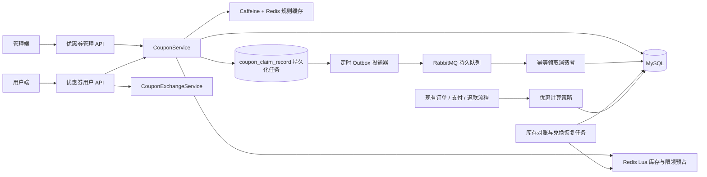

# 优惠券业务实施说明

本文记录当前项目优惠券业务的部署顺序、关键接口、业务边界和故障恢复方式。实现以现有 Spring Boot / MyBatis / MySQL / Redis / RabbitMQ、订单和微信支付路径为基础，不要求替换原有订单流程。

## 架构与关键流程

领取状态以 `coupon_claim_record` 为准：`0=处理中`、`1=成功`、`2=失败`。接口返回处理中只表示已记录并进入恢复流程，不代表优惠券已经写入用户券包。用户端可使用业务流水号查询最终结果。

### 领取与恢复顺序

1. 服务端从 `BaseContext` 获取用户 ID；请求体不接受可信用户 ID。
2. MySQL 创建唯一业务流水，Redis Lua 原子校验活动状态、库存、每人限领及幂等流水，并预占库存。
3. 领取流水作为持久化 Outbox。定时投递器确认存在 Redis 预占后发布持久 RabbitMQ 消息；启用 correlated publisher confirms 和 returns。
4. 消费者以业务流水号幂等落库。成功后在数据库事务中创建用户券、更新领取流水，并同步成功兑换记录和兑换码计数。
5. 投递失败会按退避时间重试，最多 8 次；终止失败会写明失败状态并补偿 Redis 预占。消费者异常拒绝重回队列并进入优惠券 DLQ；数据库 Outbox 仍作为重试恢复来源。
6. 定时任务对账 Redis 库存和用户领取计数与数据库；存在处理中任务时跳过该活动，防止以暂时不完整的 DB 结果覆盖 Redis。对账修复使用 Redis 锁和 Lua。

Redis 与 MySQL / RabbitMQ 不共享本地事务。失败由持久领取流水、幂等消费者、库存补偿和对账任务处理，不能依赖 Spring `@Transactional` 回滚 Redis。

### 订单、核销、取消与退款

- 下单时从数据库重新读取用户优惠券、购物车商品和优惠规则。服务端计算商品金额、包装费、配送费、优惠额和实付额；优惠金额不使用客户端传值。
- 仅支持单券；折扣策略使用 `BigDecimal` 和两位小数舍入。订单优惠与规则快照保存在 `order_coupon_snapshot`，避免模板后续变更影响历史订单。
- 条件更新将用户券由未使用状态锁定到订单；同券不能并发用于多个订单。支付成功核销，取消或超时未支付释放锁定。
- 当前增加的是全额退款记录和既有微信退款调用/通知路径；退款成功才处理优惠券返还。原券在有效期内则恢复为未使用，已过期则维持过期，不延长有效期。没有引入部分退款或优惠金额分摊。
- 核销、释放、退款状态变更均使用条件更新及订单/优惠券快照状态检查，避免重复处理。

## 数据库迁移

SQL 文件位于 `sky-server/src/main/resources/db/`。请先备份目标数据库，在部署新版本前连接项目配置的 MySQL 数据库，按顺序执行：

1. [`migration-coupon-phase1.sql`](./sky-server/src/main/resources/db/migration-coupon-phase1.sql)：模板、活动、领取流水、用户优惠券。
2. [`migration-coupon-phase2.sql`](./sky-server/src/main/resources/db/migration-coupon-phase2.sql)：订单优惠快照与全额退款记录。
3. [`migration-coupon-phase3.sql`](./sky-server/src/main/resources/db/migration-coupon-phase3.sql)：领取流水分页扫描索引。
4. [`migration-coupon-phase4.sql`](./sky-server/src/main/resources/db/migration-coupon-phase4.sql)：Outbox 重试字段及索引。
5. [`migration-coupon-phase6.sql`](./sky-server/src/main/resources/db/migration-coupon-phase6.sql)：兑换码及兑换幂等记录。
6. [`migration-coupon-phase7.sql`](./sky-server/src/main/resources/db/migration-coupon-phase7.sql)：允许草稿活动暂不设置开始和结束时间；启用活动前仍必须补齐有效时间范围。

这些脚本面向 MySQL 8+。phase1、phase2、phase6 使用 `CREATE TABLE IF NOT EXISTS`；phase3、phase4、phase7 检查 `information_schema` 后再添加索引或字段约束。重复执行不会重复创建对象，但 `IF NOT EXISTS` 不会修复已存在的错误表结构；部署前应核对目标库实际 schema。phase5 没有数据库迁移。所有金额列以元存储，使用 `DECIMAL(10,2)`；折扣率使用 `DECIMAL(6,4)`。唯一索引覆盖领取业务号、用户券与领取记录、兑换码及同码同用户兑换。

迁移只新增优惠券相关表、字段和索引，不要求改写既有订单表字段。

## 接口清单

管理端前缀 `/admin/coupon`（需管理端认证）：

| 方法 | 路径 | 用途 |
|---|---|---|
| GET | `/templates/page` | 模板分页 |
| GET | `/templates/{id}` | 模板详情 |
| POST / PUT | `/templates` | 新增 / 修改模板 |
| DELETE | `/templates/{id}` | 删除模板（按服务端规则校验） |
| POST | `/templates/{id}/status/{status}` | 启用或停用模板 |
| GET | `/activities/page` | 活动分页及统计 |
| POST / PUT | `/activities` | 新增 / 修改活动 |
| POST | `/activities/{id}/status/{status}` | 活动状态变更 |
| POST | `/exchange-codes` | 批量生成兑换码 |

用户端前缀 `/user/coupon`（需用户认证）：

| 方法 | 路径 | 用途 |
|---|---|---|
| GET | `/activities` | 查询当前可领取活动 |
| POST | `/claim` | 提交领取，响应含业务流水和处理状态 |
| GET | `/claim/{businessNo}` | 查询本人的领取处理状态 |
| POST | `/redeem` | 使用兑换码，进入同一领取流水流程 |
| GET | `/mine` | 分页查询我的优惠券，可按状态筛选 |

## 状态、规则与限制

- 优惠券类型：`1=满减`、`2=折扣`、`3=无门槛`。模板包含门槛、优惠额/折扣率/最高优惠额、有效期和适用范围。金额用 `BigDecimal`，不使用 `double`。
- 活动持久状态：`0=草稿`、`1=启用`、`2=暂停`；是否尚未开始或已结束由开始/结束时间与当前时间共同判定。后端领取逻辑始终校验状态、时间和库存。
- 草稿可先保存名称、模板和库存而不设置活动时间；启用前必须补齐有效的开始、结束时间。部署时需执行 phase7 迁移，使活动时间列允许为空。
- 用户券状态：`0=未使用`、`1=已锁定`、`2=已使用`、`3=已过期`。
- 兑换码为 24 个随机字节的 Base64URL 无填充编码（32 字符），由 `SecureRandom` 生成，数据库唯一约束兜底；每次最多同步生成 500 个，单码可配置上限和过期时间。超大批量异步生成尚未实现。
- 规则缓存仅缓存模板/活动静态规则，不缓存库存。Caffeine TTL 30 秒、Redis TTL 5 分钟；读缓存时检查 Redis 共享版本，修改规则在事务提交后推进版本。若提交后 Redis 失效操作失败，错误会记录并依赖 TTL/DB 回源恢复，实例间短时旧规则风险不能被描述为零。
- Redisson 锁仅用于活动管理中需要串行化的状态变更；库存与限领的权威并发控制仍是 Lua 和数据库条件更新/唯一索引。

## 运维与验证

依赖现有项目的 Redis、RabbitMQ 和 MySQL 配置。RabbitMQ 需要允许应用声明持久领取队列、交换机、绑定和 DLQ；发布确认及不可路由返回已在应用配置启用。应用重启时，待处理 Outbox、待处理兑换任务会由定时任务重新扫描。

本次在当前环境完成：

- `mvn test`（`backend-java` 根目录）：48 项测试通过。
- 管理端 `npm run build`：通过。
- 用户端 `npm run build`：通过。
- Phase 6 定向测试：16 项通过。
没有连接真实 MySQL、Redis 或 RabbitMQ 运行端到端/并发故障注入验证；部署时应在集成环境验证迁移、Redis Lua、Rabbit confirm/DLQ、进程重启恢复和微信退款回调。管理端构建输出存在既有大 chunk 提示；两端 npm 输出也有非致命配置警告。

## 项目描述（简历参考）

基于 Spring Boot、MyBatis、MySQL、Redis Lua、RabbitMQ、Caffeine 和 Redisson 实现外卖优惠券闭环：提供活动管理、异步幂等领券、兑换码、库存补偿与对账、策略化优惠计算，以及订单优惠快照、支付核销、取消释放和全额退款返券；通过数据库唯一约束、条件更新、持久 Outbox 和分布式缓存版本控制降低并发重复与跨系统部分成功风险。
